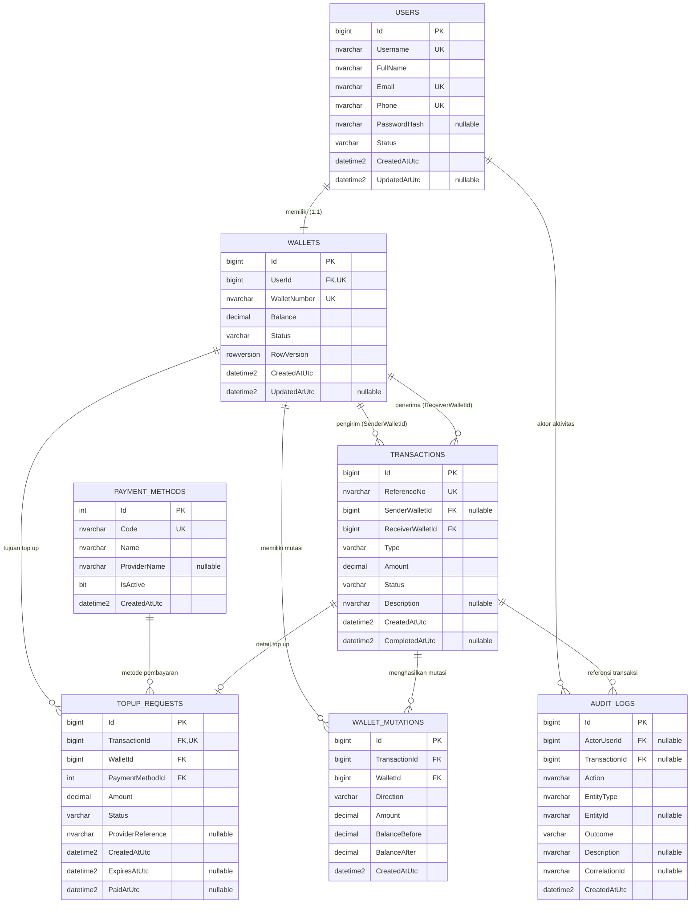

# Weekly 6 - E-Wallet RESTful API (ASP.NET Core & EF Core)

Implementasi RESTful API sistem E-Wallet berbasis **ASP.NET Core (.NET 10)**, **Entity Framework Core**, dan **SQL Server** dengan arsitektur berlapis (*Layered Architecture*: Controller, Service, Repository, DTO, dan Domain Model). Aplikasi ini mencakup pengelolaan pengguna, dompet digital, top up, transfer antar-wallet secara atomik, *optimistic concurrency* menggunakan `RowVersion`, pencatatan mutasi saldo, serta *audit logging*.

---

## Cara Menjalankan Aplikasi

### Prasyarat
- [.NET 10 SDK](https://dotnet.microsoft.com/download)
- SQL Server (LocalDB / SQL Server Express / Docker)
- EF Core CLI (`dotnet tool install --global dotnet-ef`)

### Langkah-langkah Menjalankan
1. **Clone repository ini**

2. **Konfigurasi koneksi database**
   Sesuaikan `ConnectionStrings` pada file `appsettings.json`:
   ```json
   {
     "ConnectionStrings": {
       "DefaultConnection": "Server=localhost;Database=EWalletWeekly6Db;Trusted_Connection=True;TrustServerCertificate=True;"
     }
   }
   ```

3. **Restore dependencies dan jalankan aplikasi**
   ```bash
   dotnet restore
   dotnet run
   ```

---

## Cara Menjalankan Migration

Skema database dikelola menggunakan **EF Core Code-First Migrations** berdasarkan konfigurasi Fluent API di `AppDbContext`.

1. **Menerapkan migration ke SQL Server**
   Jalankan perintah berikut pada direktori root project untuk membuat database beserta seluruh 7 tabel, constraint, dan index:
   ```bash
   dotnet ef database update
   ```

2. **Membuat migration baru (opsional jika ada perubahan entitas)**
   ```bash
   dotnet ef migrations add <NamaMigration>
   dotnet ef database update
   ```

---

## Cara Menjalankan Seeding

Data awal (*seeding*) dieksekusi secara otomatis saat aplikasi dijalankan (`dotnet run`) melalui mekanisme inisialisasi pada `Program.cs` apabila tabel database masih kosong.

Data yang di-seed meliputi:
- **Minimal 10 Users** beserta masing-masing **1 Wallet** berstatus `ACTIVE` (saldo awal `Rp0` sebelum transaksi seed).
- **Minimal 2 Payment Methods** aktif (`BANK_TRANSFER` dan `QRIS`).
- **Riwayat Transaksi Top Up & Transfer** beserta catatan `TopUpRequests`, `WalletMutations`, dan `AuditLogs` yang konsisten dengan saldo akhir masing-masing wallet.

---

## Daftar Endpoint

### 1. Users (`/api/users`)
| Method | Endpoint | Deskripsi |
| :--- | :--- | :--- |
| `GET` | `/api/users` | Mengambil seluruh daftar pengguna. |
| `GET` | `/api/users/{id}` | Mengambil detail pengguna berdasarkan `id`. |
| `POST` | `/api/users` | Mendaftarkan pengguna baru dan otomatis membuat 1 wallet `ACTIVE` dengan saldo `0`. |
| `PUT` | `/api/users/{id}` | Memperbarui data profil pengguna. |
| `GET` | `/api/users/{id}/transactions` | Mengambil histori transaksi pengguna (mendukung search `ReferenceNo`, filter `Type`, `Status`, rentang tanggal, sorting, & pagination). |
| `GET` | `/api/users/{id}/mutations` | Mengambil histori mutasi saldo wallet pengguna (mendukung filter `Direction`, rentang tanggal, sorting, & pagination). |

### 2. Wallets & Top Up (`/api/wallets`)
| Method | Endpoint | Deskripsi |
| :--- | :--- | :--- |
| `GET` | `/api/wallets/{userId}` | Mengambil informasi detail wallet milik `userId`. |
| `POST` | `/api/wallets/{userId}/topup` | Mengajukan permintaan top up (membuat `TopUpRequest` & `Transaction` berstatus `PENDING`, saldo belum bertambah). |
| `POST` | `/api/wallets/topup/{topUpRequestId}/confirm?actorUserId={actorUserId}` | Konfirmasi pembayaran top up (simulasi dev/testing): mengubah status menjadi `PAID` & `SUCCESS`, menambah saldo, membuat mutasi `IN`, dan mencatat `AuditLog`. |

### 3. Transfers (`/api/transfers`)
| Method | Endpoint | Deskripsi |
| :--- | :--- | :--- |
| `POST` | `/api/transfers` | Melakukan transfer saldo antar-wallet secara atomik (membuat 1 `Transaction` dan 2 `WalletMutations`: `OUT` pengirim & `IN` penerima). |

### 4. Payment Methods & Top Up Requests
| Method | Endpoint | Deskripsi |
| :--- | :--- | :--- |
| `GET` | `/api/payment-methods` | Menampilkan daftar metode pembayaran (mendukung filter status aktif). |
| `GET` | `/api/topup-requests` | Menampilkan seluruh daftar permintaan top up. |

---

## ERD (Mermaid)



---

## Screenshot Pengujian API

### 1. Saldo Sebelum dan Sesudah Transaksi (Top Up & Transfer)
<p align="center">
  
</p>
<p align="center">
  
</p>

### 2. Histori Mutasi Wallet (`WalletMutations`)
<p align="center">
  
</p>

### 3. Audit Logs (`AuditLogs`)
<p align="center">
  
</p>

### 4. Rollback Transaksi (Validasi Gagal / Saldo Tidak Mencukupi)
<p align="center">
  
</p>

### 5. Concurrency Conflict (`409 Conflict` via `RowVersion`)
<p align="center">
  
</p>

### 6. Pagination, Filtering, dan Sorting
<p align="center">
  
</p>

---

## Penjelasan Konsep Teknis

### Perbedaan `Transactions`, `WalletMutations`, dan `AuditLogs`

- **`Transactions`**: Berfungsi sebagai catatan utama (*header*) atas setiap aktivitas finansial (`TOPUP` atau `TRANSFER`). Tabel ini menyimpan detail sumber dan tujuan dana, nominal transaksi, nomor referensi unik (`ReferenceNo`), serta siklus status transaksi (`PENDING`, `SUCCESS`, `FAILED`).
- **`WalletMutations`**: Berfungsi sebagai buku besar (*ledger*) pergerakan saldo pada masing-masing wallet untuk setiap transaksi yang berhasil. Tabel ini mencatat arah arus dana (`IN` atau `OUT`) beserta rekam jejak saldo sebelum (`BalanceBefore`) dan sesudah (`BalanceAfter`) transaksi sehingga setiap perubahan saldo dapat direkonsiliasi secara matematis (misalnya, 1 transaksi transfer menghasilkan 2 mutasi: `OUT` pada pengirim dan `IN` pada penerima).
- **`AuditLogs`**: Berfungsi sebagai jejak audit operasional dan keamanan sistem. Tabel ini merekam seluruh aktivitas penting—baik yang berhasil (`SUCCESS`) maupun yang ditolak/gagal (`REJECTED`/`FAILED`) seperti `TOPUP_REQUESTED`, `TOPUP_PAID`, `TRANSFER_CREATED`, dan `TRANSFER_REJECTED`—lengkap dengan identitas aktor (`ActorUserId`) dan pelacak request (`CorrelationId`) tanpa menyimpan informasi sensitif seperti `PasswordHash`.

### Alasan Penggunaan `AsNoTracking`, Database Transaction, dan `RowVersion`

- **`AsNoTracking()`**: Digunakan pada seluruh query pembacaan data (*read-only*) seperti daftar pengguna, metode pembayaran, histori transaksi, dan mutasi wallet. Dengan menonaktifkan *Change Tracker* EF Core, aplikasi tidak perlu membuat *snapshot* entitas di memori sehingga penggunaan RAM lebih hemat dan eksekusi query menjadi lebih cepat.
- **Database Transaction (`BeginTransactionAsync`)**: Digunakan untuk menjamin sifat **Atomicity** (ACID) pada proses bisnis yang memodifikasi beberapa tabel sekaligus (seperti transfer antar-wallet dan konfirmasi top up). Perubahan saldo wallet, pembaruan status transaksi, pembuatan mutasi saldo, dan pencatatan audit log dibungkus dalam satu transaksi database—apabila terjadi kegagalan di tengah proses, seluruh perubahan akan di-*rollback* sehingga tidak ada data yang berubah sebagian (*partial update*).
- **`RowVersion` (Optimistic Concurrency)**: Merupakan kolom *timestamp/rowversion* yang otomatis diperbarui oleh SQL Server setiap kali baris pada tabel `Wallets` dimodifikasi. EF Core menyertakan nilai `RowVersion` saat melakukan `UPDATE` saldo; jika terdapat dua request bersamaan yang mengubah wallet yang sama, salah satu request akan mendeteksi ketidakcocokan versi dan memicu `DbUpdateConcurrencyException` (ditangani sebagai `409 Conflict`), sehingga mencegah terjadinya *race condition*, *lost update*, maupun saldo negatif.